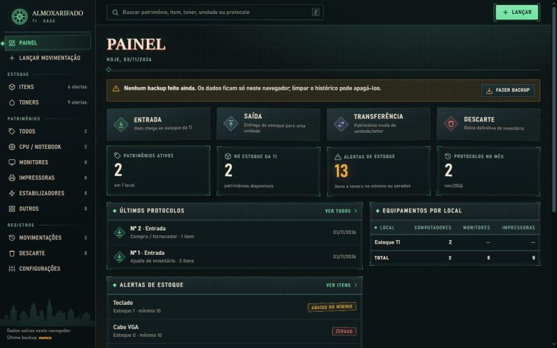
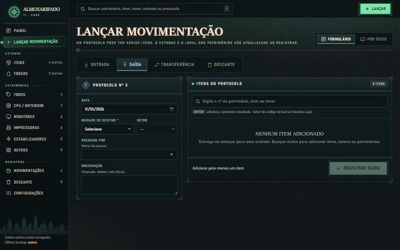
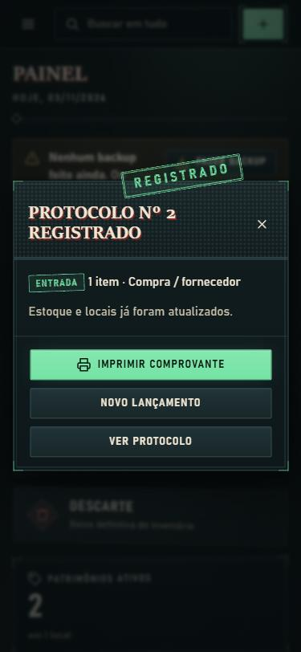

<div align="center">

# 🏛️ Almoxarifado TI

**Controle de estoque, toners e patrimônios da TI da SASC**
Um único arquivo HTML. Sem servidor, sem login, sem internet.




</div>

---

## ✨ O que ele faz

| | |
| --- | --- |
| 📦 **Estoque** | Itens e toners com estoque mínimo e alertas de nível (abaixo do mínimo / zerado). O estoque nunca fica negativo. |
| 🏷️ **Patrimônios** | Cadastro com 5 ou 6 dígitos (zeros à esquerda preservados), sem duplicados, com opção S.P. e nº da locadora à parte. Organizados por unidade e setor. |
| 🧾 **Protocolos** | Entrada, saída, transferência e descarte, cada um com número de protocolo. Só o mais recente pode ser desfeito. |
| 🖨️ **Comprovante** | Recibo de protocolo pronto para imprimir em duas vias (saída e transferência). |
| 🔎 **Busca rápida** | Um campo único para patrimônio, item, toner, unidade ou protocolo. Funciona com leitor de código de barras. |
| 💾 **Backup** | Exporta e restaura tudo em `.json`, fotos incluídas. Backups antigos continuam abrindo. |

## 🖼️ Telas

<table>
  <tr>
    <td width="60%"></td>
    <td width="40%"></td>
  </tr>
  <tr>
    <td align="center"><sub><b>Lançar movimentação</b>: vários itens por protocolo</sub></td>
    <td align="center"><sub><b>Carimbo de protocolo registrado</b>, no celular</sub></td>
  </tr>
</table>

## 🚀 Como usar

1. Baixe ou clone este repositório.
2. Abra o arquivo **`index.html`** no navegador (duplo clique).
3. Pronto. Os dados ficam salvos no IndexedDB do próprio navegador.

> ⚠️ Como os dados ficam só no navegador, limpar o histórico pode apagá-los. Faça backups periódicos pelo botão **Fazer backup**.

## 🛠️ Desenvolvimento

O código-fonte fica em `src/app.html`. O arquivo `index.html` é **gerado** pelo build, então não o edite diretamente.

```powershell
# Gera o entregável (junta app.html + seed.json + sons em base64)
& ".\build.ps1"

# Regera o seed a partir da planilha e depois rode o build
& ".\tools\extrair-planilha.ps1" -Planilha "Controle de almoxarifado TI SASC.xlsx"
```

Os dados iniciais vieram da planilha `Controle de almoxarifado TI SASC.xlsx`.

## 📁 Estrutura

```
├── src/               código-fonte (app.html), seed e sons
├── tools/             scripts auxiliares em PowerShell
├── docs/              contexto do projeto e imagens do README
├── build.ps1          gera o HTML único
├── DESIGN.md          identidade visual
├── PRODUCT.md         definição do produto
└── index.html         entregável gerado
```

## 🎨 Identidade visual

Art Déco noturno em verde "gaslamp", com cara de cartaz impresso e carimbos. Só tema escuro. Detalhes em [`DESIGN.md`](DESIGN.md).
